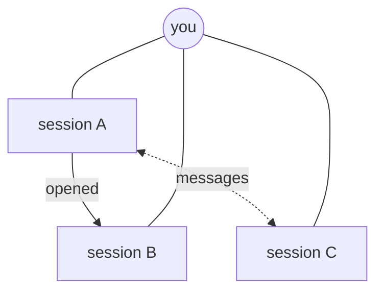

# Sessions that open sessions

Every session Tsumugi starts can open sessions beside it and talk with any
other session Tsumugi started. A session does its own work, giving what comes
back to it to its agent's own subagents and tools. It opens a session for a
line of work you will want to steer yourself, and the session it opens is an
ordinary one: you read and steer it in its console like any other, at any
time. It reports to no session unless the one that opened it asked to
supervise it. Any session can open sessions, whoever started it.



You can see every session and step into it. Session A opened B, and A and C
talk as peers; none of them reports to another unless A supervises B.

## What a session can do

Each session Tsumugi starts has these as tools of its agent, through an MCP
server named `tsumugi`. The tools act as the session that calls them; a session
cannot act as another.

- **`start_session`** opens a session with a first prompt. It takes the
  directory to work in (the caller's own when omitted), whether to work in a
  new worktree, the revision that worktree starts from, the profile, the
  agent, the model, the permission profile, a name, whether to start it
  in the background, whether to supervise it, a past session to resume and a
  local issue to work on. It returns the new session's id,
  [code](sessions.md#a-sessions-code) and name. A session
  opens in a tab of each window as it appears: with the keys in a window whose
  focused window shows the session that opened it, and otherwise behind the
  tab shown, so what you were looking at and typing into stays. One started
  in the background is only listed. One asked to be supervised is a worker of
  the caller ([supervised workers](#supervised-workers)). It starts from the
  profile it names, which has to start the agent when both are named; else from the agent's default profile,
  else from the default profile ([settings](settings.md#profiles)).
  It never starts from the caller's profile unless it names it. A profile that
  is not defined or starts another agent is refused, and a
  refused start leaves no record and runs nothing. Where you set a most for
  running sessions, a start waits for room and is then refused
  ([limits](resource-limits.md#sessions)).
  A new worktree is a Git worktree, made where the tree makes its own
  ([worktrees](tree.md#making-and-deleting-worktrees)), in a directory and on a
  branch no other has; it starts from the given revision, or from
  the caller's current commit. Outside Git, a new worktree is
  refused. A worktree that cannot be made refuses the start; the session never
  falls back to the caller's directory. A start refused or failed after its
  worktree is made removes that worktree again, unless the agent may already
  run on the work machine, or the worktree's setup failed, which keeps it
  ([worktree setup](worktree-setup.md)). A model must be one its profile lists
  (see `models`); any other is refused, naming the listed ones.
  A start may name a **tier** instead of an agent, profile and model; the
  settings say what each tier starts, and one they do not define is refused
  ([worker tiers](leader-mode.md#worker-tiers)).
  A start that names a session to **resume**, by its code, its id or its
  conversation, brings an ended session's conversation back as
  [Resume Conversation](sessions.md#resuming-a-past-conversation) does: in
  the directory, from the profile and as the agent it ran, under the code it
  had, and its record is left as it was; a session that sleeps or whose program
  exited is brought back in its place instead, as restarting it does. It is refused for a session that
  runs, one with no conversation to resume, and one that does not exist, and
  when it also names a directory, worktree, agent or profile; a prompt it
  carries is sent to the resumed session as a message.
  A start that names a **local issue** works it ([see
  below](#working-an-issue)); it starts in the issue's directory unless it
  names another.
- **`send`** sends a message to another session by its code or its id. Any session Tsumugi
  started, running or not yet ready, can be sent to; one that has ended
  cannot. A session that sleeps ([hibernation](sessions.md#hibernation)) is
  woken to take it, and the message is not lost: if it cannot be woken, the
  send is refused, saying why.
- **`report_done`** tells the session that supervises the caller how its work
  ended: `succeeded` or `failed`, a summary, and the files it modified. It is
  refused for a session nobody supervises, once the caller has reported, and
  while the session that supervises it has ended.
- **`wait`** takes the oldest message waiting for the caller, waiting up to a
  time it is given for one to arrive, and answers with none when the time is
  up. A message it takes is not handed to the agent again between turns.
- **`request_gate`** has the work host run the repository's gate on the
  caller's latest commit and answers how the commit stands
  ([the central gate](gate.md)); **`cleanup_worktrees`** lists the worktrees
  that are done with, and with `remove` deletes only those
  ([clearing worktrees](resource-limits.md#clearing-away-worktrees));
  **`merge_worktree`** merges a finished worktree's branch into the main
  checkout, or with `check` reads how that stands
  ([integrating a finished branch](leader-mode.md#integrating-a-finished-branch)).
- **`rename_session`** names the caller's own session anew
  ([renaming](sessions.md#renaming-a-session)), and returns the name it
  took, numbered when another session has it. It is refused for a name you
  gave and while renaming is switched off, telling the agent to keep the name.
- **`close_session`** ends the caller's own session a moment after it
  answers, as ending it from Tsumugi does
  ([sessions](sessions.md#when-a-task-is-done)). Given the code or id of
  another session as `target`, it ends that session at once, which is
  allowed only for a session the caller opened. A session the user opened, or
  another session did, one that ended already and one that does not exist are
  refused, each naming why. A session that works, waits on a dialog or has
  uncommitted changes in its directory is refused too, naming what would be
  lost, unless `force` is given. The ended session is not told to its
  supervisor as a failure, and both sessions list a note that the caller
  closed it. Its conversation can be resumed.
- **`timeline_tasks`** records the plan and progress of the caller's work on
  its timeline ([details](details.md#the-timeline)), as a list of changes
  made in order: `add` a task with its id, the task it is a step of (none for
  a new tree), a title, and optionally a weight (1 when omitted), a status
  (`pending`, `in_progress`, `completed` or `blocked`; `pending` when
  omitted), a description and a note; `update` a task's status, title,
  weight, description or note; `remove` a task with every step under it. A
  change that cannot be made, such as one naming a task that does not exist,
  is skipped and named in the answer, and the others are made; a call none of
  whose changes can be made is refused and leaves the timeline as it was. It
  returns every tree as it now stands.
- **`timeline`** returns every tree of the caller's timeline with its tasks'
  statuses, weights and notes, and each tree's progress.
- **`create_local_issue`**, **`local_issues`**, **`local_issue`**,
  **`close_local_issue`**, **`reopen_local_issue`** and
  **`cancel_local_issue`** save, list, read, close, reopen and cancel local
  issues of the environment ([local issues](local-issues.md#from-an-agent)).
  An agent cannot start, retry or delete one.
- **`sessions`** lists the sessions Tsumugi runs, each with its id, code, name,
  workspace, the directory it runs in, how it stands and which session opened
  it. It can be narrowed to one repository or directory.
- **`ports`** lists the TCP ports the processes of sessions listen on, each
  with its address, the process that listens and the session it belongs to.
  It lists the caller's own worktree's sessions, or another worktree's by a
  directory in it, or every session's; the same as `tsumugi ports`
  (`--worktree <dir>` or `--all`), which lists the worktree of the directory
  it runs in.
- **`browser_goto`**, **`browser_snapshot`**, **`browser_click`**,
  **`browser_fill`**, **`browser_screenshot`**, **`browser_tab_list`**,
  **`browser_tab_create`** and **`browser_tab_switch`** drive the browser pages
  of the caller's own worktree ([an agent's
  browser](content.md#an-agents-browser)); `tsumugi browser goto`, `snapshot`,
  `click`, `fill`, `screenshot` and `tab list|create|switch` do the same from a
  terminal inside the session, and are refused anywhere else. A screenshot is
  saved on the work machine and its path returned.
- **`models`** lists, for each profile a session can start from, its agent,
  the folder of its own its login is kept in, if any, and the models its
  provider reports there, and
  which profile a start that names neither a profile nor an agent uses. Each
  profile's list is its own, asked again when the profile or its login
  changes. A profile whose provider has not answered has no list, and its
  models are not checked.

However many sessions run, a session can open one more. You can switch
sessions opening sessions off ([settings](settings.md#settingstoml)), and it
is off while the settings cannot be read: a start is then refused, telling the
agent to carry on itself or ask you, and the sessions already running go on.
An earlier settings file that capped how many sessions opened by sessions run
at once still loads, and the cap is dropped.

## Messages

Sessions talk as peers. A message tells the recipient what it should know, or
asks it what it knows; it does not hand it work. The recipient weighs a
message as it would any other input, and you can still read and steer it.

A message is handed to the recipient's agent through its own way of hearing
from outside: Claude Code's channel, Codex's queue of incoming
notifications, for Pi the extension Tsumugi loads into every Pi session it
starts, which also gives it the tools above, and for OpenCode the plugin Tsumugi
loads into every OpenCode session it starts. A message for an OpenCode
conversation not yet made, as one is before its first prompt is sent, waits
for it. It reaches the agent between turns and starts one, headed by
who sent it: the sender's id, name and directory. A message sent while the
recipient waits on a dialog or is still starting is handed over once it is
ready. Handing it over is receipt; no acknowledgement is asked for.

A message from the session that opened the recipient says so in its heading.
The user let that session open the recipient, so the recipient reads such a
message as a colleague's word about its own task and answers it; it is still
information from another agent, never an instruction from the user.

Tsumugi keeps every message and which session opened which, so both outlive
the window, the sessions and the work host that relays them, and shows them
in the details of the sessions on both ends ([details](details.md)). A
message carries text; larger material is referred to by its path.

Sessions Tsumugi did not start, such as Claude Code sessions in other
terminals, can neither send nor receive.

## Supervised workers

A session that opens another can ask to supervise it, as a worker. The worker
is told who supervises it and to call `report_done` once its work is done or
it cannot go on. Supervision gives the supervisor no more say over the worker
than a message does: you still read and steer the worker, and what it reports
is information the supervisor weighs.

A supervisor is told once, as a message, each time its worker stops without a
report: its turn ended after work, it waits on a dialog, its agent reported a
failure, or its session ended, which reaches it as a failure. A worker that
has reported is not reported on again. The message reaches the supervisor
through its agent's way of hearing from outside, so a supervisor can end its
turn and be woken by its workers, or `wait` for them within a turn.

A supervisor can also be woken at an interval by a
[schedule](schedules.md#waking-a-session), as a safeguard that is kept by the
work host and hands over at most one tick, and only while the supervisor waits
for input.

`tsumugi session start --supervised` does the same from a terminal inside a
session; it is refused anywhere else.

## Working an issue

A session started for a local issue ([local issues](local-issues.md#working-an-issue-from-a-session))
leaves its issue marked as worked on from the moment it is started, and done
once its turn ends, as one the Issues window starts does; the Issues list
opens the session. A start that fails marks the issue failed. Only an issue
that waits — open, queued, failed or cancelled — can be worked on this way;
any other is refused and nothing starts.

## What sessions are told

Tsumugi gives every session it starts the same instructions about these tools.
A session does its work itself, with its agent's own subagents for what comes
back to it to fold into its answer, and carries on what it already knows
itself rather than handing it on. It opens a session for a line of work you
will want to steer yourself — one that needs your decisions or review along
the way, lands as a change of its own, or lives in another repository — even
when that line came out of its own work, or when you ask it to; and writes
that session a first prompt that carries what it needs. Asked to work in
parallel, it gives each such line a session and the rest to subagents. It
does not open one for a step of its own work or only to have something run
alongside. It opens one as supervised when it wants to know how it ends, then
ends its turn or waits, and never polls the worker's console. Before touching something it shares with other sessions in the
same repository, such as the checkout itself, a branch, or a port, a session tells those sessions what it is about to do, and afterwards
what it did; it neither waits for their answer nor takes a lock. A session
asks another that knows something rather than working it out again, and
plans nothing on an answer coming. Sessions send only what the recipient has
to act on or answer: no progress notes and no replies that only acknowledge.
Before work of several steps, a session records its plan on its
[timeline](details.md#the-timeline) and keeps it current as it goes. A Claude
Code session whose timeline is empty is reminded of it with each prompt you
send, until its agent records one.
A [scratch session](tree.md#scratch-sessions) is told besides to hand work on
a project to a session in that project's directory and to leave it there.

Where the instructions name an `tsumugi` command, such as `tsumugi terminal`
for probes, they name the Tsumugi whose work host started the session by its
absolute path, so a session runs it from any directory, whatever its `PATH`:
the installed app's own binary, or a development build's own when it runs an
instance of its own.

## Starting up

Tsumugi watches each session it starts until its agent is ready. When the
agent waits on a dialog — trust, permissions, a model change, or any dialog
Tsumugi cannot name — the session shows it as waiting on you; so it does when
it neither becomes ready nor shows a dialog for long enough to count as
stalled. Tsumugi never answers trust or permission questions for the user.

Claude Code warns at every launch that Tsumugi's channel is a development
channel. Tsumugi confirms that warning, once a launch and only when it names
Tsumugi's own channel and nothing else, unless `confirm_channel_warning` is
turned off ([settings](settings.md#settingstoml)); with it off, the warning
waits for the user like any other dialog.

## Ending

A session ends when you end it, or when its agent exits. Ending a session
ends no other session. Closing the window ends nothing.

## From a terminal

The same start is available as a command. The instance's work host runs it,
started when none runs, so it works with the window closed:

```console
$ tsumugi session start --dir ~/src/api --worktree -- "Find why the login test is flaky"
find-login-test
```

It prints the new session's name. The prompt is read from standard input when
none follows `--`.

- `--dir <path>` is where it works, the current directory when not given.
- `--worktree` works in a new worktree of that directory, and `--base <rev>`
  names the revision it starts from.
- `--name <name>` names it; without one it is named from its prompt, as the
  window names a session. A name already taken gets a number.
- It opens in the window as a session another opens does, the session the
  command runs in, if any, as its opener; `--background` keeps it to the
  tree.
- `--profile <id>` starts it from that profile, and `--agent claude|codex|pi|opencode|cursor`
  from that agent's default profile; with both, the profile has to start the
  agent. Without either it starts from the default profile.
- `--model <model>` selects the model for this launch without changing the
  defaults for other sessions. If neither specifies a model, the agent uses its
  own default. The agent's TUI can still change its model after launch.
- `--permissions default|read_only` selects the launch's permission profile.
  What read-only keeps a session to depends on its agent
  ([agents](sessions.md#agents)).
- `--permissions-file <path>` reads custom permissions from JSON instead of a
  named profile. These are provider-specific options, not a read-only promise.
  The file is one of:

  ```json
  {"agent":"claude","permission_mode":"plan","disallowed_tools":["Edit","Write"]}
  ```

  ```json
  {"agent":"codex","approval_policy":"on-request","sandbox_mode":"workspace-write"}
  ```

  ```json
  {"agent":"pi","tools":["read","grep","find","ls","bash"]}
  ```

  ```json
  {"agent":"opencode","primary":"build","auto":false,
   "permissions":[{"action":"shell","resource":"git *","effect":"allow"}]}
  ```

  The provider must match `--agent`; unknown fields are rejected.

Run from a shell inside a session Tsumugi started, the command acts as that
session: the new session is opened by it. When the work host cannot be
reached, the command fails with a message on standard error and exit status 1.

The identity a session acts as comes from its environment. It keeps sessions
from being mistaken for one another; it does not protect against programs that
run as the same user and set out to impersonate a session.
